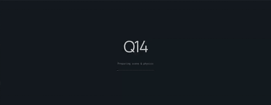

# Demo, use and checks (details)

[Back to README](../README.md)

A runnable three.js quadruped playground backed by hand-written spatial rigid-body dynamics. The browser supports a **trained sensor-driven trot, 40 movable gravel rocks, and experimental 3D particle water**. It is not yet the complete simulator in `BUILD_REQUEST.md`.

```sh
npm install
npm run dev
```

## Demo

| Trained trot on loose gravel (40 dynamic rocks) | Experimental SPH water |
|---|---|
|  |  |
| [mp4](media/gravel-walk.mp4) · physics ran at 0.17x real time; GIF sped up 5x | [mp4](media/water.mp4) · 0.16x real time; GIF sped up 5x |



*Flat-ground trot with the footprint overlay, real time (1.01x). [mp4](media/flat-trot.mp4).*

Captured 2026-11-06 with `scripts/capture-demo.mjs` in system Chrome on an RTX 5080 desktop, rendering on the GPU. The
real-time factors come from the simulator's own clock: simulated seconds divided by wall seconds over each clip. Every
link pose is taken from the physics Worker; the renderer adds no animation.


Open http://localhost:5173. Vite supplies the COOP/COEP headers required by SharedArrayBuffer. Opening `index.html` directly will not work. `npm run build` creates `dist/`; `npm run preview` also supplies the required headers.

## Use

- The app opens on **Loose gravel**. Press **Tumble rock** to apply an off-center impulse, or **Walk forward** to traverse the section. Use Stand to stop the gait. Hold W/S for forward/reverse and A/D to turn; releasing keys zeroes the command. Reverse and turning remain exploratory.
- Choose **Water** for experimental 1,120-particle SPH with two-way link forces. The wire outline is a fluid computational boundary, not a rigid tank.
- Drag to orbit, scroll to zoom, or enable follow camera.
- Shift-drag any robot link to apply an impulse at the picked point. The button applies a 2 N·s lateral impulse at the base.
- Pause/resume with Space or the button. Single-step advances 1 ms while paused.
- Adjust time scale, PD gains, friction and terrain roughness live.
- Reset after a fall. Slopes, stairs, the beam and ice are exploratory scenes; only straight trot on flat ground and gravel has walking validation.
- Toggle normal-force arrows, contact indicators and the projected footprint. These are measured foot normal forces; the footprint is not a contact-filtered support polygon.

The rendered link poses come only from the physics Worker. Rendering interpolates previous/current physics poses. There is no rendered walking animation, pose correction, ground snapping, scaled gravity or velocity clamp.

## Checks

```sh
npm test
npm run build
node scripts/browser-smoke.mjs
node scripts/capture-demo.mjs   # README GIF sources: screenshots + webm per scene (HEADED=1 for GPU rendering)
```

The browser smoke check requires the development server and an installed Google Chrome. It saves desktop/mobile screenshots under `artifacts/`.
